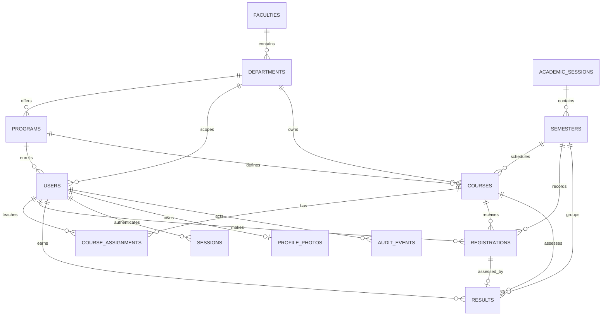

# VarsityONE Database Design

**Document status:** schema reference for the SQL migrations in this repository, reviewed 3 November 2026. Neon PostgreSQL is the production system of record. This describes the schema actually created by migrations `001`–`003` plus the migration runner's metadata table; it does not describe a proposed future schema.

## 1. Storage and migration model

The application uses Node.js `pg` with TLS certificate verification and a Neon pooled connection string. SQL migrations are stored in `migrations/` and applied by `npm run db:migrate`. The runner acquires advisory lock `71024011`, applies each new file in its own transaction, records a SHA-256 checksum, and fails if an already-applied migration's checksum changes. It creates the metadata table `schema_migrations` before applying application migrations.

The API checks database connectivity and the presence of migration records during initialization. It does not create the core academic schema or automatically seed university records at ordinary startup. The login-rate-limit table is idempotently ensured by migration `002` and by API startup for compatibility. Run migrations explicitly before deploying code that requires them.

## 2. Entity relationship model

The full column definitions and keys for each entity follow in the table reference below.

`schema_migrations` is operational metadata, not an academic entity: `name text PRIMARY KEY`, `checksum char(64) NOT NULL`, `applied_at timestamptz NOT NULL DEFAULT now()`.

## 3. Tables and constraints

### `faculties`

| Column | Definition |
|---|---|
| `id` | Integer identity primary key. |
| `name`, `code` | Required text. `code` is unique; `lower(name)` has a unique index. |
| `created_at` | Required `timestamptz`, defaults to `now()`. |

### `departments`

| Column | Definition |
|---|---|
| `id` | Integer identity primary key. |
| `faculty_id` | Required FK to `faculties`, delete restricted. |
| `name`, `code` | Required text. `code` is unique. `(faculty_id,name)` is unique; `lower(name)` is also globally unique. |
| `created_at` | Required `timestamptz`, defaults to `now()`. |

`UNIQUE(id,faculty_id)` is present to support a composite scoped foreign key from the user record's programme/department pair.

### `programs`

| Column | Definition |
|---|---|
| `id` | Integer identity primary key. |
| `department_id` | Required FK to `departments`, delete restricted. |
| `name`, `code` | Required text. `code` is globally unique; `(department_id,lower(name))` is unique. |
| `duration` | Required `smallint`, default 4, check 1–8 years. |
| `created_at` | Required `timestamptz`, defaults to `now()`. |

`UNIQUE(id,department_id)` is present to enforce programme/department consistency from `users` and `courses` through composite foreign keys.

### `academic_sessions` and `semesters`

`academic_sessions` has identity `id`, unique required `name`, `is_current boolean NOT NULL DEFAULT false`, and `created_at`. The name must match `YYYY/YYYY`. A partial unique index allows at most one row with `is_current=true`.

`semesters` has identity `id`, required `session_id` FK to `academic_sessions` (`ON DELETE RESTRICT`), required `name`, `is_current boolean NOT NULL DEFAULT false`, and `created_at`. Name is restricted to `First Semester`, `Second Semester` or `Third Semester`; `(session_id,name)` is unique. A separate partial unique index allows at most one current semester across the table. An index covers `session_id`.

The database permits no current session/semester and does not itself require the current semester's parent session to be current. Application administration updates the two flags together when making a semester current.

### `users`

| Column | Definition |
|---|---|
| `id` | Integer identity primary key. |
| `email` | Required text; unique case-insensitively through `lower(email)`. |
| `password_hash` | Required text containing the application scrypt salt and derived hash; no plaintext password column. |
| `role` | Required text in `student`, `lecturer`, `department_admin`, `super_admin`. |
| `name` | Required text, trimmed length 2–100. |
| `status` | Required text, default `active`; allowed `active`, `suspended`, `inactive`. |
| `department_id` | Nullable FK to `departments`, delete restricted. Super admins must have no department. |
| `program_id` | Nullable; paired with `department_id` in a composite FK to `programs(id,department_id)`, delete restricted. |
| `level` | Nullable `smallint`; if set, 100–800 in increments of 100. |
| `matric_no` | Nullable text; case-insensitive-by-upper unique index when present. |
| `staff_no` | Nullable text; case-insensitive-by-upper unique index when present. |
| `created_at`, `updated_at` | Required `timestamptz`, default `now()`. `updated_at` is maintained by a `BEFORE UPDATE` trigger. |
| `phone` | Added by migration 003; nullable text, length 7–30 when set. Phone-format validation is performed by the API. |
| `avatar_version` | Added by migration 003; non-negative integer, default 0. Incremented when the profile photo changes/removes. |
| `avatar_has_photo` | Added by migration 003; required boolean, default false. |

Role/profile check constraints require students to have programme, level and matriculation number; non-students must have null programme, level and matriculation number. `users_program_scope_fk` ensures a student's programme belongs to their selected department. Staff identifiers are optional in SQL and required only where application flows request them. Indexes support `(department_id,role,status)` and student `(program_id,level)` lookup.

### `courses`

`courses` includes integer identity `id`; required `code`, `title`, `units`, `department_id`, `program_id`, `level` and `semester_id`; `is_active boolean NOT NULL DEFAULT true`; and `created_at`/`updated_at` timestamps. Code is unique. Title length after trim is 2–180, units 1–10, and level 100–800 by hundreds. Department and programme are both required and a composite FK ensures the selected programme belongs to that department. Department and semester deletion are restricted. `updated_at` is maintained by trigger. A partial index on `(semester_id,department_id,program_id,level)` covers active courses.

### `course_assignments`

Composite primary key `(course_id,lecturer_id)` links courses to assigned lecturer users. `assigned_by` is a nullable FK to users; `assigned_at` defaults to `now()`. Course and lecturer deletion cascade to the allocation; deleting the assigning user sets `assigned_by` to null. SQL checks that referenced rows exist, while the API verifies the assigned user is an active lecturer in the course's department. An index supports lookups by `(lecturer_id,course_id)`.

### `registrations`

`registrations` has integer identity `id`; required `student_id`, `course_id`, `semester_id`; and `registered_at DEFAULT now()`. All three FKs use `ON DELETE RESTRICT`. `(student_id,course_id,semester_id)` is unique. `UNIQUE(id,student_id,course_id,semester_id)` is a cohort key used by other relationships. Indexes support course/semester roster retrieval and student/semester history.

The registration API restricts inserts to the authenticated student, active eligible courses in the current semester, matching department/programme/level and batches of at most 40 courses. The SQL foreign keys do not independently enforce that `student_id` has role `student` or that the course remains eligible; those are API workflow rules.

### `results`

| Column | Definition |
|---|---|
| `id` | Integer identity primary key. |
| `student_id`, `course_id`, `semester_id` | Required integers tied by a composite FK to a matching registration. Deleting a registration cascades to its result. |
| `ca` | `numeric(5,2) NOT NULL DEFAULT 0`, range 0–30. |
| `exam` | `numeric(5,2) NOT NULL DEFAULT 0`, range 0–70. |
| `total` | `numeric(5,2) NOT NULL DEFAULT 0`, range 0–100 and must equal `ca + exam`. |
| `grade` | Required text, default F; A–F only. |
| `grade_point` | `numeric(2,1) NOT NULL DEFAULT 0`, range 0–5. |
| `status` | Required text, default `draft`; `draft`, `submitted`, `approved` or `rejected`. |
| `feedback` | Nullable text, maximum length 2,000. Required by API for a reviewer return, not as a general SQL constraint. |
| `submitted_at`, `reviewed_at` | Nullable timestamps set by API workflow. |
| `updated_at` | Required timestamp, default `now()`, maintained by API writes. |

`(student_id,course_id,semester_id)` is unique. The composite FK references the matching registration key, so a result cannot be for an unregistered student/course/semester combination. Indexes cover result status by course/semester and student/status/semester. The API—not a database trigger—calculates the grade and points from total; the SQL schema constrains ranges/status values but does not guarantee that grade and grade point correspond to total.

### `audit_events`

`audit_events` has bigint identity `id`; nullable `actor_id` FK to users (`ON DELETE SET NULL`); required `action` (length 3–100), `entity_type` (length 2–50), optional integer `entity_id`, required `details jsonb DEFAULT '{}'`, and `created_at DEFAULT now()`. Indexes support newest-first timelines, actor timelines, entity history, and JSON containment/path searches using `jsonb_path_ops` GIN.

Product handlers append audit rows for authentication, registration, grading/review, profile changes and administration. There is no application update/delete route. The schema itself does not prohibit a privileged direct database operator from updating or deleting rows; retention and privileged-operator controls belong to the database/hosting environment.

### `sessions`

`token_hash char(64)` is the primary key and stores a SHA-256 hash of a random session token, never the raw cookie value. `user_id` is required FK to users with cascade delete. `expires_at` is required; `created_at` and `last_seen_at` default to `now()`. Indexes support lookup by user and expiry cleanup. The application creates eight-hour sessions; current-request validation checks expiry and active user status. The `last_seen_at` column is not refreshed by the current request handler.

### `profile_photos`

Added by migration 003. `user_id` is the primary key and FK to users with cascade delete. `mime_type` must equal `image/jpeg`; `image_bytes bytea` must contain 1–307,200 bytes; `updated_at` defaults to `now()`. The API validates base64/JPEG structure and dimensions up to 2,048 × 2,048 and 4,194,304 pixels, returns the photo as private/no-store, and maintains `users.avatar_version`/`avatar_has_photo`. Database constraints do not parse JPEG contents or verify that the flag agrees with the photo row.

### `login_rate_limits`

Added by migration 002; also created idempotently during API initialization. `key_hash char(64)` is the primary key; `window_started_at`, `updated_at` are required timestamps; `attempts` is a positive integer. An index on `updated_at` supports stale-row cleanup. The application stores an HMAC-derived IP key, not a plaintext IP. The rolling policy is 12 attempts per 15-minute window, with successful login clearing the counter and old counters cleaned periodically.

## 4. Relationships and deletion semantics

| Relationship | Referential behavior |
|---|---|
| Faculty → department | `RESTRICT`; faculty with departments cannot be deleted through a raw delete. |
| Department → programme/user/course | `RESTRICT`; records preserve academic ownership. |
| Programme → student/course composite scope | `RESTRICT`; programme and department must match. |
| Academic session → semester → course/registration/result | `RESTRICT` at session/semester/course links; preserve term history. |
| Course/lecturer → course assignment | `CASCADE`; deleting either removes allocation. Assigner deletion sets `assigned_by` null. |
| User/course/semester → registration | `RESTRICT`; enrollment history cannot be removed through parent deletion. |
| Registration → result | `CASCADE`; if a registration is explicitly deleted by an authorized DB operation, its corresponding result is deleted. |
| User → session/profile photo | `CASCADE`; deleting a user removes its auth sessions and photo. |
| User → audit actor | `SET NULL`; retain event, remove deleted actor reference. |

`audit_events.entity_id` is intentionally polymorphic and has no foreign key. Foreign keys/check constraints do not enforce current-term selection, role membership for every FK-linked user, assignment active status, result state-transition history, or grade-to-score calculation; those are API policies described in [`TECHNICAL.md`](TECHNICAL.md).

## 5. Index and uniqueness inventory

| Table | Index/constraint | Purpose |
|---|---|---|
| Faculties | unique code; unique `lower(name)` | Prevent duplicate codes/names. |
| Departments | unique code; unique `(faculty_id,name)`; unique `(id,faculty_id)`; unique `lower(name)` | Identity, scoped FK target and globally unique department names. |
| Programs | unique code; unique `(id,department_id)`; unique `(department_id,lower(name))` | Identity and scoped FK target. |
| Academic sessions | unique name; partial unique current row | Session identity and at-most-one current session. |
| Semesters | unique `(session_id,name)`; partial unique current row; index `session_id` | Semester identity and current lookup. |
| Users | unique `lower(email)`; partial unique `upper(matric_no)`/`upper(staff_no)`; `(department_id,role,status)`; partial student `(program_id,level)` | Identity, scoped admin search and student eligibility. |
| Courses | unique code; partial active `(semester_id,department_id,program_id,level)` | Course identity and active-term eligibility. |
| Course assignments | PK `(course_id,lecturer_id)`; index `(lecturer_id,course_id)` | Allocation uniqueness and lecturer course lookup. |
| Registrations | unique `(student_id,course_id,semester_id)`; unique `(id,student_id,course_id,semester_id)`; course-term-student and student-term-course indexes | Duplicate prevention, result FK target and roster/transcript access. |
| Results | unique student-course-term; status-course-term; student-status-term-desc | One result per registration and review/transcript queries. |
| Audit events | time/id desc; actor/time desc; entity/time desc; JSONB GIN | Audit feeds and detail search. |
| Sessions | token hash PK; user id; expiry | Session lookup, account revocation and cleanup. |
| Login rate limits | key hash PK; updated-at | Counter lookup and cleanup. |

## 6. Migration history

| File | Change |
|---|---|
| `001_initial.sql` | Academic hierarchy; users; sessions and semesters; courses and lecturer allocations; registrations; results; audit events; authentication sessions; core checks, foreign keys, indexes and `updated_at` triggers. |
| `002_distributed_login_rate_limit.sql` | Persistent, database-shared login rate counters and cleanup index. |
| `003_profile_contact_and_photo.sql` | User phone/avatar metadata and constrained JPEG photo storage. |

Do not edit a migration after it has been applied. Add a new sequentially named SQL migration, review it against the production Neon branch, and apply it through the migration runner. The runner's checksum table makes altered history a startup/release error rather than silently accepting drift.

## 7. Seeded data and credential storage

`npm run db:seed-institution` explicitly provisions synthetic academic records under a production confirmation guard. It creates or upserts 3 faculties, 9 departments/programmes, 42 lecturers, 189 students and 432 courses, then generates lecturer assignments, six registrations per seeded student, result workflow states and audit examples. It uses a single serializable transaction and a separate advisory lock. The active owner super-admin at `odinigwechu137@gmail.com` must already exist. Four operator-supplied, distinct test passwords are required for the named department-admin, lecturer and two student test accounts; passwords for additional synthetic accounts are random. Only password hashes are persisted.

The seed's expected `432` courses are 9 departments × 4 levels × 12 course topics. It creates three faculties and one programme per department. Student eligibility and score totals are represented in the actual rows and are also protected by the constraints listed above. The seed is not executed automatically on deployment or server startup.

No production database URL, password, session token, API key, or raw user credential belongs in this document. Use a secrets manager for deployment and operator-only seed values.
