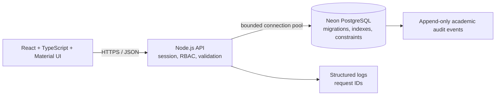

# VarsityONE Technical Notes

## Architecture

The React/TypeScript client uses Material UI and Vite. It calls a same-origin JSON API. The Node.js API owns all authentication, authorization and business rules. Neon PostgreSQL stores academic records, hashed sessions and audit events. The production build is served by the API; local development uses Vite's `/api` proxy.

## Roles and permissions

| Capability | Student | Lecturer | Department Admin | Super Admin |
|---|:---:|:---:|:---:|:---:|
| View/update own permitted details | Own name | View own profile | — | — |
| Browse courses | Own department, programme, level and active semester | Assigned courses | Own department | University-wide |
| Register a course | Own account only | — | View scoped registrations | View all |
| View class lists | — | Assigned courses | Own department | University-wide |
| Save/submit CA and exam | — | Assigned courses | — | — |
| Approve or return results | — | — | Own department | University-wide |
| View results | Own approved results only | Assigned course results | Own department | University-wide |
| Manage faculties/departments | — | — | — | University-wide |
| Manage programmes/courses/allocations | — | — | Own department | University-wide |
| Create accounts/manage status | — | — | Own department | University-wide |
| Change roles | — | — | — | University-wide |
| View reports/audit | — | — | Own department | University-wide |

API routes repeat these checks server-side. Lecturer result writes require a matching course assignment. Department administrators are scoped to their assigned department. Student registration ignores any client-supplied student ID and uses the authenticated identity. Students receive only approved result rows.

## Data workflows

### Course registration

The API checks the active semester, course status, department, programme and academic level in one query. It inserts the selected course IDs using `UNNEST` in one transaction. A serializable transaction retries serialization failures and deadlocks with bounded backoff. A database unique constraint prevents a student enrolling in the same course twice within a semester.

### Result lifecycle

`draft → submitted → approved` or `draft → submitted → rejected → submitted → approved`.

CA is 0–30; examination is 0–70. Scores and grade points are validated and calculated on the server. Whole class results are persisted with one bulk `UNNEST` insert/upsert. The API locks the course result cohort while it checks the registered roster, so concurrent submissions cannot bypass completeness or edit locks. Department approval is one transaction and fails unless every registered student has submitted a score. Approved and submitted results are locked; a returned result requires administrator feedback and may be corrected by the assigned lecturer.

### Database protection

PostgreSQL constraints independently enforce unique emails, matriculation/staff numbers, course codes, programme/course department consistency, registration uniqueness, result-to-registration relationships and score ranges. Indexes cover course eligibility, registrations by course and semester, student transcripts, assignment ownership, pending results, audit lookups and session expiry. Migrations are checksummed and serialized with a PostgreSQL advisory lock.

## Authentication and operations

Passwords use scrypt with a random 128-bit salt. Session IDs are random 256-bit opaque tokens in an HttpOnly, SameSite=Strict, eight-hour cookie. Only a SHA-256 hash is stored in Neon. Logout, status changes and role changes revoke the user's sessions. Production adds the Secure cookie attribute and requires HTTPS.

The API limits login attempts, caps JSON request bodies at 1 MB, checks origins on mutations, sets security headers, applies SQL statement/lock/idle-transaction timeouts, and emits JSON error logs with request IDs. Client IP forwarding is ignored unless `TRUST_PROXY=true`; set that only behind a trusted reverse proxy. Health checks verify the database. The pool is configurable, defaults to ten connections and uses the Neon pooled endpoint.

Start-up fails if `DATABASE_URL` is unset, Neon cannot be reached, or schema migrations have not been applied. Run `npm run db:migrate` as a release step before deploying application code. Institutional seed data is written to Neon only by an explicit operator command with a production confirmation guard.

## HTTP API outline

| Endpoint | Method | Access |
|---|---|---|
| `/api/login`, `/api/logout`, `/api/me`, `/api/health` | POST/GET | Public/session |
| `/api/dashboard`, `/api/courses` | GET | Signed-in; data scoped by role |
| `/api/registrations` | GET/POST | Signed-in / student POST |
| `/api/results` | GET | Signed-in; own approved or staff-scoped results |
| `/api/courses/:id/results` | GET | Assigned lecturer, scoped department admin, super admin |
| `/api/courses/:id/results` | POST | Assigned lecturer |
| `/api/courses/:id/review` | POST | Department admin or super admin |
| `/api/admin/bootstrap` | GET | Department admin or super admin |
| `/api/admin/faculties`, `/departments`, `/programs`, `/sessions`, `/semesters`, `/users`, `/courses`, `/assignments` | POST | Scoped administrative role |
| `/api/admin/users/:id/status` | PATCH | Scoped administrator |
| `/api/admin/users/:id/role` | PATCH | Super admin |
| `/api/admin/courses/:id/status` | PATCH | Scoped administrator |
| `/api/reports`, `/api/audit` | GET | Scoped administrators |

Unauthenticated protected requests return `401`; denied roles and cross-department requests return `403`. Unique and foreign-key conflicts return safe `409` messages. Raw database error text and connection details are never returned to the client.
