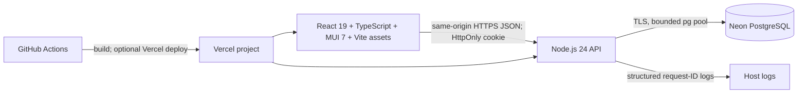

# VarsityONE Technical Reference

**Document status:** implementation reference for the repository on `main`, reviewed 3 November 2026. This describes behavior present in source and migrations; it is not a statement that unimplemented integrations exist.

## 1. Product boundary

VarsityONE is a responsive university academic management web application. It supports student course registration and approved-result viewing; lecturer class lists, score entry, correction and submission; department administration and result review; and university-wide administration, reporting and audit review.

The application does not connect to an external examination/testing product. Lecturers enter CA and examination scores in VarsityONE. The API validates those marks and computes total, grade and grade point. Admissions, fees, accommodation, attendance, MFA, password recovery, external identity providers, messaging gateways, native mobile applications, certified transcripts and integration with another student information system are outside the implemented product boundary.

## 2. Repository map

| Path | Responsibility |
|---|---|
| `src/main.tsx` | React entry point, font imports, Material UI theme provider, CSS baseline and global stylesheet. |
| `src/App.tsx` | Login, role navigation, page composition, dashboards, filters, tables, dialogs, notifications and profile UI. |
| `src/api.ts` | Same-origin `fetch` wrapper, cookie credentials, JSON parsing and HTTP error conversion. |
| `src/types.ts` | Client role, user, term and generic row types. |
| `src/theme.ts` | Material UI palette, typography, shape and component defaults. |
| `src/styles.css` | Layout, responsive breakpoints, navigation themes, print rules, interactions and reduced-motion behavior. |
| `server.js` | Node HTTP server, PostgreSQL pool, authentication, authorization, validation, transactions, API handlers, static file server and lifecycle. |
| `api/router.js` | Vercel serverless adapter; validates and translates rewritten `/api/*` paths to the common handler. |
| `migrations/*.sql` | Ordered PostgreSQL schema changes. The migration runner records their checksums. |
| `scripts/migrate.cjs` | Applies ordered migrations under a PostgreSQL advisory lock and refuses modified applied migrations. |
| `scripts/create-admin.cjs` | Guarded, one-time first-super-admin bootstrap. |
| `scripts/seed-institution-data.cjs` | Explicitly guarded, transactional synthetic university-data seed. |
| `scripts/qa-production-api.cjs` | Opt-in production API workflow check; it creates disposable QA records and cleans them up. |
| `scripts/connection-string.cjs` | Normalizes PostgreSQL URLs to `sslmode=verify-full`. |
| `scripts/inspect-db-target.cjs` | Prints non-secret Neon host/database/SSL target metadata. |
| `index.html`, `public/*` | Application metadata and branded logo/favicon assets. |
| `vite.config.ts`, `tsconfig*.json`, `package.json` | TypeScript/Vite build, local API proxy, split frontend bundles and scripts. |
| `vercel.json`, `.github/workflows/production-deploy.yml` | Vercel routing/security/cache configuration and GitHub Actions build/deploy workflow. |
| `Dockerfile`, `compose.yaml`, `.dockerignore` | Multi-stage container build and local container deployment. |
| `README.md`, `DATABASE.md`, `DEMO.md` | Setup, data model and walkthrough documentation. |

## 3. Runtime architecture

The API is the authority for identity, scope, validation, grading and workflow transitions. Browser filtering and previews are presentation conveniences, not security boundaries. All persistent application records are read from and written to Neon PostgreSQL; the client does not ship a static roster or use a local database. `localStorage` holds only the selected sidebar appearance and per-user read-notification IDs.

### Browser application

The client uses React 19, TypeScript 5, Vite 7, Material UI 7, Emotion and locally bundled Manrope/Plus Jakarta Sans variable fonts. `React.StrictMode`, `ThemeProvider` and `CssBaseline` wrap the app. The client uses a single-page state router rather than a URL router: the selected page is held in React state and navigation comes from role-specific sidebar items, the workspace breadcrumb menu, notifications and profile controls. Refresh restores authentication from `/api/me`; a deep link to a named page is not defined.

Role workspaces expose these pages:

| Role | Navigation |
|---|---|
| Student | Overview, Course catalogue, My registration, Academic results, My profile (profile is opened from the sidebar account). |
| Lecturer | Overview, My courses, Class lists, Results, My profile. |
| Department Admin | Overview, Department courses, Registrations, Result review, Reports, Department setup, Activity log, My profile. |
| Super Admin | Overview, Course catalogue, Registrations, Result approvals, University reports, Administration, Activity log, My profile. |

Shared UI includes searchable/classifiable tables, pagination, print views, responsive drawer navigation, a dark/glass navigation appearance switch, account profile/photo editing, a notification menu and transient success/error notices. Motion honors `prefers-reduced-motion`.

### API hosting

On a standalone Node deployment, `server.js` serves `dist/` and handles `/api/*`. In Vercel, `vercel.json` rewrites `/api/:path*` to `api/router.js`; the adapter validates the route suffix (rejecting `..`), initializes the shared database checks, and calls `handleRequest`. A database initialization failure returns a no-store `503`, a five-second `Retry-After` and a request ID. Vercel's Node function is limited to 30 seconds by configuration.

## 4. Identity, sessions and authorization

Roles are `student`, `lecturer`, `department_admin` and `super_admin`. Accounts also have `active`, `inactive` or `suspended` status. `/api/me` resolves the `uemp_session` cookie by hashing its opaque token and joining an unexpired session to an active user. It returns the current user profile and current semester; it never returns a password hash.

Passwords are stored as `salt:derived-key`, using Node `scrypt`, a random 16-byte salt and a 64-byte derived key. Verification uses a timing-safe byte comparison. On successful login, the server creates a random 32-byte base64url session token with an eight-hour expiry; only its SHA-256 hash is stored in `sessions`. The cookie is `HttpOnly`, `SameSite=Strict`, path `/`, and gains `Secure` in production. Login, logout, profile credential changes and account status/role changes are audited as applicable. Changing account email/password revokes every other session for that user but retains the current session. Suspension, inactivity and role changes revoke all target sessions.

Authorization is enforced in server handlers on every protected endpoint. Students can only act as their authenticated identity. Lecturer class and result endpoints require an assignment for the requested course. Department administrators are restricted to their department; super administrators have university-wide scope. Result approval is restricted to department administrators and super administrators, so the lecturer cannot approve their own submission. Super-admin account browsing and full profile/photo inspection are super-admin-only.

## 5. HTTP API reference

All paths below include the `/api` prefix. JSON mutation payloads are same-origin and use the session cookie. Responses set `Cache-Control: no-store`; JSON includes `X-Content-Type-Options: nosniff`. `401` means no valid session, `403` means forbidden scope/role, `409` means an academic or uniqueness conflict, and unexpected server errors return a generic message with a request ID.

### Health and session

| Method and path | Access | Behavior |
|---|---|---|
| `GET /health` | Public | Checks Neon with `SELECT 1`; returns ready/degraded status without database connection details. |
| `POST /login` | Public | Validates credentials, rate limit, active status; creates a session and writes `auth.login`. |
| `POST /logout` | Session optional | Deletes the presented session, records `auth.logout` when resolvable, clears cookie. |
| `GET /me` | Session optional | Returns current user or `null`, plus current semester. |

Login attempts share a database-backed counter keyed by an HMAC of the client IP. The window is 15 minutes and attempts above 12 are rejected with `429`; successful login clears the counter. Old counters are pruned on the periodic cleanup path.

### Academic work and results

| Method and path | Access | Behavior |
|---|---|---|
| `GET /dashboard` | Any authenticated role | Role-specific dashboard counts and current-term summary. |
| `GET /notifications` | Any authenticated role | Up to 20 role/scope-specific approved-result, returned-result or pending-review notifications. Read state is client-side only. |
| `GET /courses` | Any authenticated role | Current-term course list filtered by student eligibility, lecturer assignment, department or university scope. |
| `GET /registrations` | Any authenticated role | Registration list filtered to the student's own records, assigned lecturer courses, department, or university. Response capped at 1,000 rows. |
| `POST /registrations` | Student | Registers 1–40 unique eligible current-term course IDs atomically; database uniqueness prevents duplicates. |
| `GET /results` | Any authenticated role | Students receive approved results only; lecturers receive assigned-course results; administrators receive scoped results. Response capped at 2,000. |
| `GET /courses/:id/results` | Assigned lecturer, scoped department admin, super admin | Returns course and registered-student roster with any saved score/status/feedback. |
| `POST /courses/:id/results` | Assigned lecturer | Saves a class as draft or submits the complete roster. CA is 0–30, exam 0–70; server computes total, grade and grade point. Draft/rejected results can be changed; submitted/approved rows are locked. |
| `POST /courses/:id/review` | Scoped department admin, super admin | Approves a complete submitted class or returns it with required feedback. The transition is transactional and audited. |

Grade bands: A 70–100 (5), B 60–69 (4), C 50–59 (3), D 45–49 (2), E 40–44 (1), F 0–39 (0). The lecturer submits a full registered roster; the API checks cohort size, unique student IDs and registration membership inside a serializable transaction before one bulk `UNNEST` upsert. A reviewer may return submitted results with feedback. The lecturer can then correct and resubmit. Approved marks are not editable through the lecturer route. Only approved results are shown to students. CGPA is computed as the credit-unit-weighted mean of approved grade points.

### Administration, reporting and audit

| Method and path | Access | Behavior |
|---|---|---|
| `GET /admin/bootstrap` | Department admin, super admin | Supplies academic structure, scoped users, courses and allocations for administration UI. |
| `GET /admin/students/:id/profile` | Super admin | Returns a full student profile and registration/unit/approved-result counts for the current semester. |
| `GET /admin/students/:id/photo` | Super admin | Streams the student's stored JPEG photo if present. |
| `GET /admin/accounts` | Super admin | Paginated role/status/search account browser (page size 1–100; search up to 100 characters). |
| `GET /admin/accounts/:id/profile` | Super admin | Returns full user profile and role-specific current workload/managed-account summary. |
| `GET /admin/accounts/:id/photo` | Super admin | Streams stored account JPEG photo if present. |
| `GET /reports` | Department admin, super admin | Returns active-account counts, current-term course registration totals, active student directory, and approved-course performance. Scope is departmental for department admins. |
| `GET /audit` | Department admin, super admin | Returns latest 100 events; department admins see events attributable to their department's users or courses. |
| `POST /admin/faculties` | Super admin | Creates a faculty. |
| `POST /admin/departments` | Super admin | Creates a department within a faculty. |
| `POST /admin/programs` | Department admin, super admin | Creates a programme in the permitted department. |
| `POST /admin/sessions`, `POST /admin/semesters` | Super admin | Creates academic sessions or semesters; optionally makes the chosen record/current parent current. |
| `PATCH /admin/faculties/:id` | Super admin | Updates faculty name/code. |
| `PATCH /admin/departments/:id` | Super admin; department admin in scope | Updates department faculty/name/code; department admin cannot move it to another faculty. |
| `PATCH /admin/programs/:id` | Super admin; department admin in scope | Updates programme department/name/code/duration. |
| `PATCH /admin/sessions/:id`, `PATCH /admin/semesters/:id` | Super admin | Updates session/semester details and current designation. |
| `POST /admin/users` | Department admin, super admin | Creates permitted role accounts in authorized department. Initial password length: 10–256. |
| `PATCH /admin/users/:id` | Department admin in scope, super admin | Updates name/email/phone; email change revokes that account's sessions. |
| `PATCH /admin/users/:id/status` | Department admin in scope, super admin | Activates, inactivates or suspends another user; a user cannot change their own status. |
| `PATCH /admin/users/:id/role` | Super admin | Changes role and associated academic/staff identifiers; cannot change own role; revokes target sessions. |
| `POST /admin/courses` | Department admin, super admin | Creates a course attached to a programme and semester in allowed scope. |
| `PATCH /admin/courses/:id` | Department admin in scope, super admin | Changes code/title/units. |
| `PATCH /admin/courses/:id/status` | Department admin in scope, super admin | Activates or deactivates a course. |
| `POST /admin/assignments` | Department admin, super admin | Assigns an active lecturer to a course in the same department. |
| `DELETE /admin/assignments/:courseId/:lecturerId` | Department admin in scope, super admin | Removes that lecturer-course allocation. |

### Profile

| Method and path | Access | Behavior |
|---|---|---|
| `GET /profile/photo` | Authenticated user | Returns own JPEG photo, if present. |
| `PUT /profile/photo` | Authenticated user | Stores a validated JPEG data URL (maximum 300 KiB; dimensions at most 2,048 × 2,048 and 4,194,304 pixels) and increments avatar version. |
| `DELETE /profile/photo` | Authenticated user | Removes own photo and increments avatar version. |
| `PATCH /profile` | Authenticated user | Updates own name and optional phone; writes an audit event. |
| `PATCH /profile/credentials` | Authenticated user | Requires current password; changes email and/or password. New password is 12–128 characters and must include uppercase, lowercase, digit and symbol. Duplicate email is rejected. Other sessions are revoked. |

## 6. Data and transaction rules

Neon PostgreSQL is the system of record. Schema details, exact columns, foreign keys, checks, indexes and deletion semantics are documented in [`DATABASE.md`](DATABASE.md). Important transaction boundaries are:

- Migration files run one at a time in transactions while a session-level advisory lock serializes migration runners. SHA-256 checksums prevent silent edits to already-applied migrations.
- Registration and result submission use serializable transactions with up to three bounded retries for serialization/deadlock SQLSTATEs `40001` and `40P01`.
- Result review updates the entire course/semester submission as one transaction and appends the corresponding audit record in the same transaction.
- User/profile/credential updates combine sensitive writes, session revocation and audit events transactionally where implemented.
- Database constraints remain the final enforcement layer for unique identities, valid score ranges, registration/result linkage and department/program consistency.

There is no automated database write on ordinary startup. Migrations and institutional data seeding are explicit operator actions. The institutional seed requires an exact production confirmation value, `VARSITYONE_TARGET_BRANCH=production`, a Neon hostname, four unique test passwords of at least 20 characters, and an existing active owner super-admin at `odinigwechu137@gmail.com`. It runs under a separate advisory lock and serializable transaction. It builds 3 faculties, 9 departments/programmes, 42 lecturers, 189 students and 432 courses (12 per department-level combination across 4 levels), plus assignments, registrations, result workflow examples and audit history. Synthetic roster passwords are random; they are not printable or recoverable from the hashes.

## 7. Security, errors and operations

- Database TLS verifies the server certificate (`rejectUnauthorized: true`); PostgreSQL connection URLs are normalized to `sslmode=verify-full`.
- Pool defaults: up to 10 connections in standalone Node and 5 in Vercel; configurable with `DB_POOL_MAX` and `DB_POOL_MIN`. Connection timeout 10 s, idle timeout 30 s, max connection lifetime 30 min, statement timeout 8 s, lock timeout 3 s, idle-transaction timeout 10 s, TCP keepalive enabled.
- JSON request bodies are limited to 1 MB. Mutations with an `Origin` header require same-host origin in production; local `APP_ORIGINS` are allowed outside production. No cross-origin credentialed API is configured.
- Security headers include CSP, `X-Content-Type-Options`, `X-Frame-Options: DENY`, `Referrer-Policy`, and a restrictive `Permissions-Policy`. API and image responses are not cacheable. Vercel gives hashed frontend assets a one-year immutable cache.
- Database and unexpected errors are logged as structured JSON with a request ID; callers receive a safe message. Conflict SQLSTATEs map to `409`; serialization exhaustion maps to retryable `503`.
- Expired sessions and stale rate-limit records are cleaned periodically. The standalone process drains the pool on `SIGINT`/`SIGTERM`; its shutdown timeout is 15 seconds.
- App audit events are append-only through the application API (there are no product update/delete routes for them); direct database operators remain outside this application-level guarantee.

### Environment variables

| Variable | Purpose |
|---|---|
| `DATABASE_URL` | Neon PostgreSQL connection URL; preferred name. `NEON_DATABASE_URL` is accepted as fallback by API/scripts. |
| `NODE_ENV`, `VERCEL_ENV`, `VERCEL` | Runtime mode, Secure-cookie selection and Vercel behavior. |
| `PORT` | Standalone HTTP port; defaults to `3000`. |
| `DB_POOL_MAX`, `DB_POOL_MIN` | PostgreSQL pool sizing. |
| `APP_ORIGINS` | Comma-separated local development origins. |
| `TRUST_PROXY` | Enables forwarded client IP in non-Vercel hosting only when set to `true`; trust only a controlled reverse proxy. |
| `AUTH_RATE_LIMIT_SECRET` | Optional HMAC key for IP rate-limit identifiers; database URL is the fallback secret. |
| `VARSITYONE_ADMIN_EMAIL`, `VARSITYONE_ADMIN_NAME`, `VARSITYONE_ADMIN_PASSWORD` | One-time initial super-admin bootstrap (`UEMP_ADMIN_*` aliases are supported). Password must be 16–256 characters. |
| `VARSITYONE_CONFIRM_PRODUCTION_DATA`, `VARSITYONE_TARGET_BRANCH` | Exact seed safeguard values; set only for an intentional production seed. |
| `VARSITYONE_TEST_HOD_PASSWORD`, `VARSITYONE_TEST_LECTURER_PASSWORD`, `VARSITYONE_TEST_STUDENT_PASSWORD`, `VARSITYONE_TEST_STUDENT2_PASSWORD` | Four unique seed-account passwords, each 20–256 characters. |
| `VARSITYONE_QA_BASE_URL`, `VARSITYONE_QA_DEMO_CREDENTIALS` | Optional base URL and JSON account credentials for the opt-in production QA script. `DATABASE_URL` is also required by that script. |

Never commit populated `.env` files, connection strings, deploy tokens or passwords. `.env.example` contains placeholders only. The seed script does not print synthetic user passwords.

## 8. Build, deploy and maintenance

### Local development

Requirements are Node.js 24 and npm. Install locked dependencies with `npm ci`; set `DATABASE_URL` in a private `.env`; apply schema with `npm run db:migrate`; start API and Vite in separate terminals with `npm run dev:api` and `npm run dev`. Vite serves port 5173 and proxies `/api` to port 3000. Run `npm run build` for TypeScript project checks and the optimized static bundle. `npm start` serves that bundle and the API on port 3000.

Available scripts: `npm run db:migrate`, `npm run db:create-admin`, `npm run db:seed-institution`, and `npm run qa:production-api`. The production QA script is mutating: it provisions temporary accounts/academic records and removes them in its cleanup. Use only against an approved target with the required owner/database credentials.

### Vercel

`vercel.json` uses `npm ci`, `npm run build` and `dist`; API requests route through `api/router.js`. Configure the Neon production URL as a sensitive Vercel environment variable. Apply migrations as an explicit release step before the application expects the new schema. The live app uses `https://varsityone.vercel.app`.

GitHub Actions `.github/workflows/production-deploy.yml` runs `npm ci` and `npm run build` on pull requests and pushes to `main`; successful main builds attempt a Vercel production deployment. The deploy job requires the repository Actions secret `VERCEL_TOKEN` plus the configured Vercel organization/project IDs. If that secret is absent, the workflow intentionally records that deployment was skipped. A green build alone is not proof of a Vercel release.

### Docker

The Dockerfile builds frontend assets in a Node 24 Alpine stage, then installs production-only dependencies and copies API, migrations, scripts and `dist` into the runtime stage. It runs as the unprivileged `node` user and health-checks `/api/health`. Compose publishes port 3000 only on loopback and requires `DATABASE_URL`. For public deployment, terminate TLS at a trusted proxy, set `NODE_ENV=production`, configure exact origins, and enable `TRUST_PROXY=true` only if the app is inaccessible except through that proxy.

## 9. Verification and known boundaries

`npm run build` validates strict TypeScript and emits Vite assets. `scripts/qa-production-api.cjs` contains an optional production API exercise for authentication, scope, account/structure management, registration, result grading/review, reporting and cleanup; it is not run automatically by the build workflow and requires explicit DB credentials. No document here claims an external exam-system integration, automated migration during deployment, or a public/reviewer-accessible GitHub repository.
